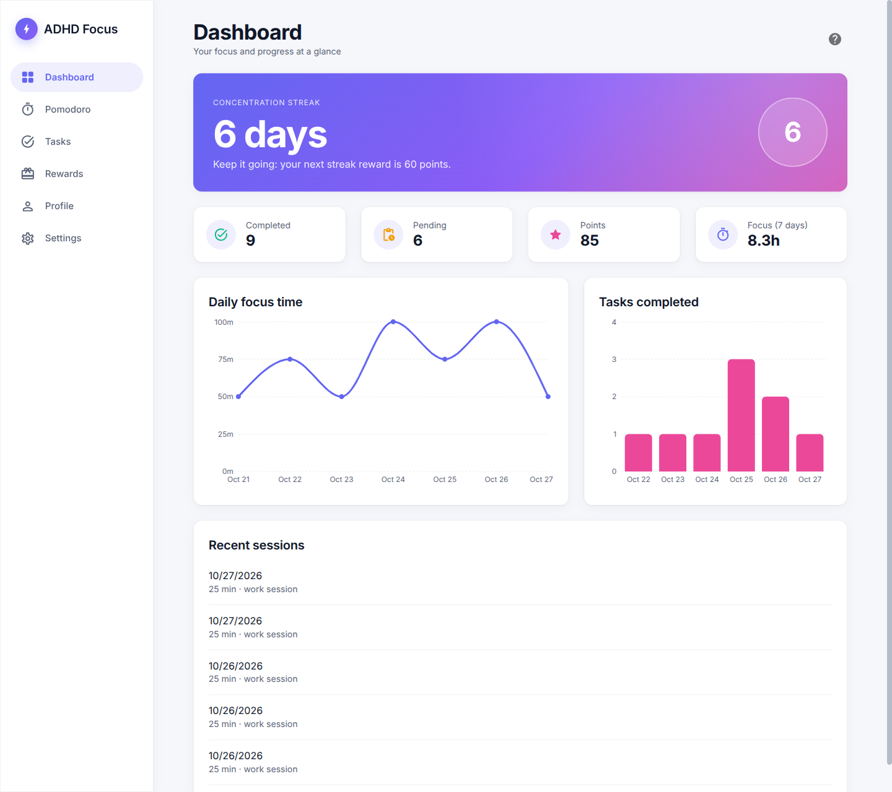
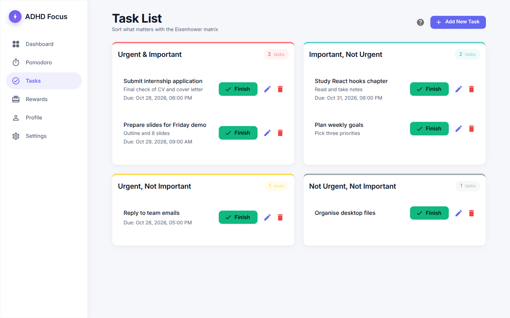
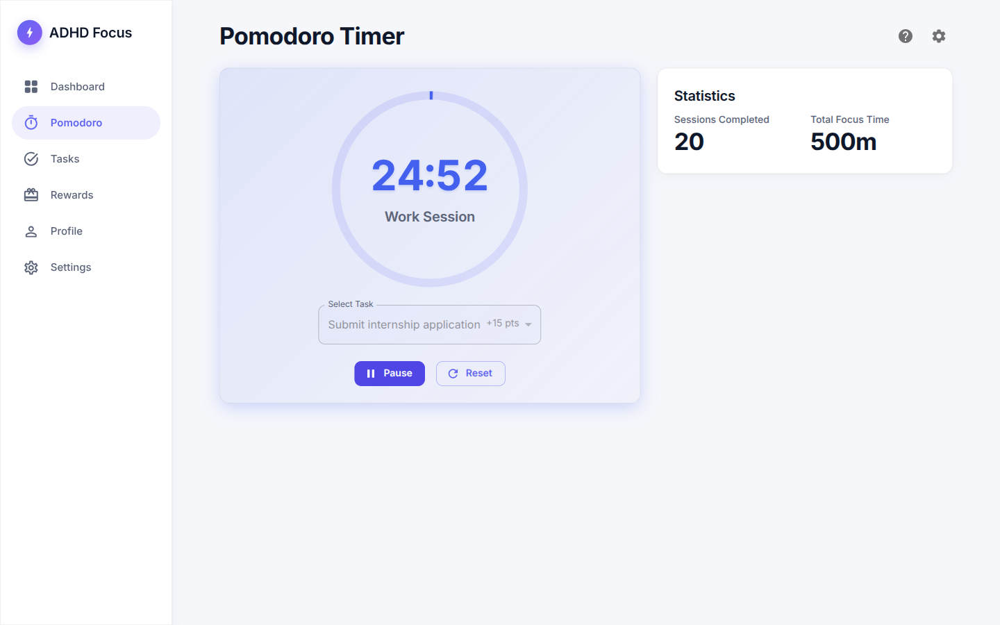
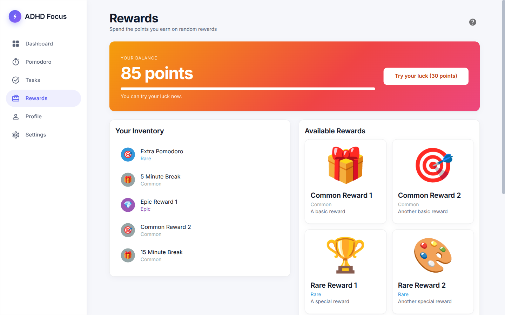
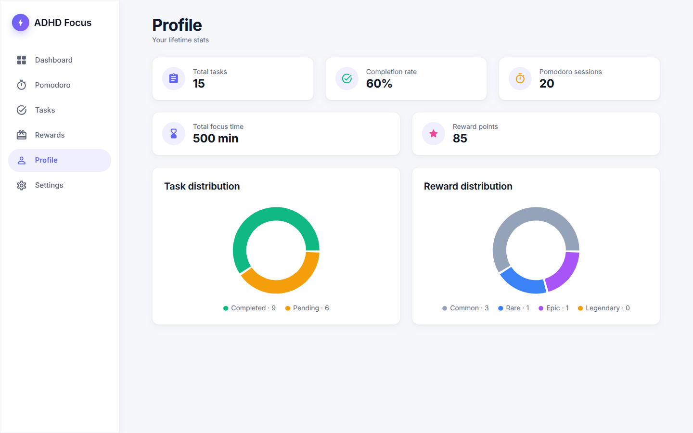
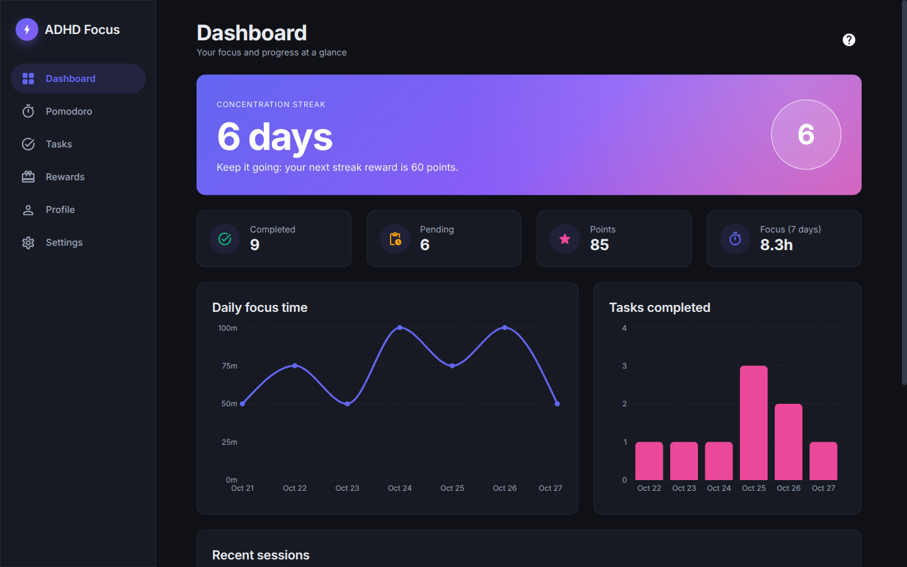
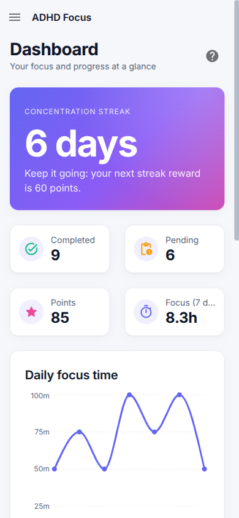

# ADHD Focus App

Task and focus tool for people with ADHD: Pomodoro timer, Eisenhower-matrix task list,
daily focus streaks and a gacha-style reward system. Data stays in the browser (`localStorage`).

**Stack:** React 18, TypeScript, Vite, MUI, Zustand, Recharts, Vitest, ESLint, Prettier. Backend: Node, Fastify, PostgreSQL, Drizzle ORM, Zod.

## Screenshots



| Tasks (Eisenhower matrix)            | Pomodoro timer                             |
| ------------------------------------ | ------------------------------------------ |
|  |  |

| Rewards                                  | Profile                                  |
| ---------------------------------------- | ---------------------------------------- |
|  |  |

| Dark mode                                         | Mobile                                                                       |
| ------------------------------------------------- | ---------------------------------------------------------------------------- |
|  |  |

## Features

- Pomodoro timer with per-task sessions and configurable work/break length
- Eisenhower matrix (Q1–Q4) with points per quadrant and overdue penalties
- Dashboard charts: tasks completed and focus minutes per day, streak counter
- Rewards: spend points on a gacha with four rarities, inventory view
- Dark mode, sound cues, browser notifications

## Getting started

```bash
npm install
npm run dev        # http://localhost:5173
```

| Script              | Purpose                      |
| ------------------- | ---------------------------- |
| `npm run dev`       | Dev server                   |
| `npm run build`     | Typecheck + production build |
| `npm test`          | Vitest                       |
| `npm run lint`      | ESLint                       |
| `npm run typecheck` | `tsc --noEmit`               |
| `npm run format`    | Prettier                     |

See [PROJECT_STRUCTURE.md](PROJECT_STRUCTURE.md) for the folder layout.

## Deploy

Import the repo in Vercel (framework preset: Vite). `vercel.json` rewrites all routes to `index.html` for client-side routing.

## Backend (work in progress)

`server/` is a REST API with PostgreSQL. The web app still uses `localStorage`; switching it to the API is the next step.

```bash
cp server/.env.example server/.env   # set JWT_SECRET for anything beyond local dev
npm run db:up                        # Postgres 16 in Docker on port 5433
npm run db:migrate                   # apply migrations
npm run dev:server                   # API on http://localhost:3001
npm run test:server                  # API tests (in-memory Postgres, no Docker needed)
```

| Method     | Endpoint                                         | Purpose                                                                                                          |
| ---------- | ------------------------------------------------ | ---------------------------------------------------------------------------------------------------------------- |
| POST       | `/api/auth/register`, `/api/auth/login`          | Create an account or sign in (httpOnly cookie, 7 days)                                                           |
| POST       | `/api/auth/logout`                               | Clear the session                                                                                                |
| GET, PATCH | `/api/auth/me`                                   | Current user; change display name or IANA time zone                                                              |
| GET        | `/api/tasks?status=open\|done`                   | List own tasks                                                                                                   |
| POST       | `/api/tasks`                                     | Create a task                                                                                                    |
| PATCH      | `/api/tasks/:id`                                 | Update fields that were sent                                                                                     |
| POST       | `/api/tasks/:id/complete`                        | Mark done and pay the quadrant points (once)                                                                     |
| DELETE     | `/api/tasks/:id`                                 | Delete a task                                                                                                    |
| POST       | `/api/sessions/start`                            | Start a Pomodoro (`plannedMinutes`: 15, 25, 45, 60, 90, 120)                                                     |
| POST       | `/api/sessions/:id/complete`                     | Finish it: rejected until the time has really passed, then pays points and updates the streak in one transaction |
| POST       | `/api/sessions/:id/cancel`                       | Abandon a running session                                                                                        |
| GET        | `/api/sessions`, `/api/sessions/streak`          | Completed sessions, current streak                                                                               |
| GET        | `/api/points`                                    | Balance and the last 50 ledger entries                                                                           |
| GET        | `/api/rewards/catalog`, `/api/rewards/inventory` | Rewards and what the user owns                                                                                   |
| POST       | `/api/rewards/gacha`                             | Spend 30 points on a server-side roll                                                                            |

**Rules enforced on the server**

- Points are an append-only ledger; the balance is the sum of its rows. A task or session can pay out only once (unique per user, reason and reference), so retries are safe.
- The gacha roll and the payment happen in one transaction that locks the user row, so parallel pulls cannot spend the same points twice.
- A streak day needs 60 focus minutes in the user's own time zone. A shorter day does not reset an existing streak; missing a whole day does. From day 2 the day that reaches the goal pays `streak x 10` bonus points.

Schema lives in `server/src/db/schema.ts`; after changing it run `npx drizzle-kit generate` inside `server/`. Passwords are hashed with argon2id, every task query is scoped to the signed-in user, and `/auth/register` and `/auth/login` are rate limited.

## Debug helpers (browser console)

```js
localStorage.removeItem('reward-storage'); // reset points and inventory
```

## License

MIT
