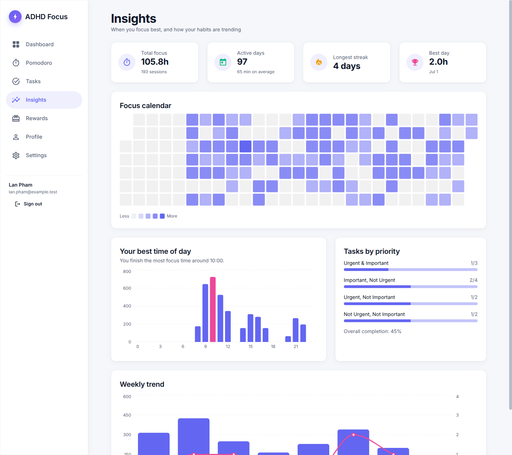
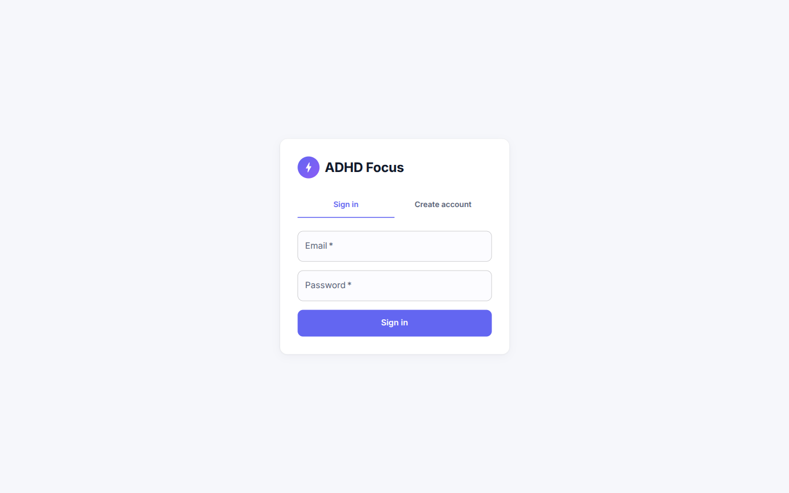

# ADHD Focus App

Task and focus tool for people with ADHD: Pomodoro timer, Eisenhower-matrix task list,
daily focus streaks and a gacha-style reward system. Accounts and data live in PostgreSQL.

**Stack:** React 18, TypeScript, Vite, MUI, TanStack Query, Zustand, Recharts, Vitest, ESLint, Prettier. Backend: Node, Fastify, PostgreSQL, Drizzle ORM, Zod.

## Screenshots




| Sign in                                | Tasks (Eisenhower matrix)            |
| -------------------------------------- | ------------------------------------ |
|  |  |

| Pomodoro timer                             | Rewards                                  |
| ------------------------------------------ | ---------------------------------------- |
|  |  |

| Profile                                  | Dark mode                                         |
| ---------------------------------------- | ------------------------------------------------- |
|  |  |


## Features

- Accounts with httpOnly-cookie sessions; every query is scoped to the signed-in user
- Pomodoro timer: the server checks the time really passed before it pays points, so sessions cannot be farmed
- Eisenhower matrix (Q1-Q4) with points per quadrant, repeating tasks (daily or weekly) and an overdue penalty job
- Streaks counted per day in your own time zone, with bonus points from day 2
- Task steps (a small checklist per task) with optional AI suggestions: Claude splits a big task into 3-8 concrete steps and you pick which to keep
- Push notifications (Web Push): a reminder when a task is due within the hour and when a focus session ends, even with the tab closed
- Installable as an app (PWA): the shell works offline, your data stays on the server
- Reduce-motion setting; dark mode and motion preferences are remembered and follow your system the first time
- Insights: focus calendar (heatmap), best time of day, weekly trend, completion by priority
- Rewards: a server-side gacha with four rarities, an append-only points ledger
- Dark mode, sound cues, installable from a single `docker compose` command

## Getting started

The app needs the API and its database. Three terminals (or one after another in the background):

```bash
npm install
cp server/.env.example server/.env   # set JWT_SECRET to a long random string
npm run db:up                        # PostgreSQL 16 in Docker, port 5433
npm run db:migrate                   # create the tables
npm run dev:server                   # API on http://localhost:3001
npm run dev                          # web on http://localhost:5173 (proxies /api to the API)
```

Optional: set `ANTHROPIC_API_KEY` in `server/.env` to switch on "Suggest steps with AI" (model from `AI_MODEL`, default `claude-opus-5-5`; a smaller model such as `claude-haiku-5-5` is cheaper). Without a key the button is simply hidden.

Optional: for push notifications create keys with `npx web-push generate-vapid-keys` and set `VAPID_PUBLIC_KEY`, `VAPID_PRIVATE_KEY` and `VAPID_SUBJECT` (for example `mailto:you@example.com`) in `server/.env`; then turn them on in Settings. Browsers only allow push on `localhost` or HTTPS, and on iPhone only for an app added to the Home Screen.

Create an account on the sign-in screen. Tasks saved in the browser before accounts existed can be imported from the banner on first sign-in (points and rewards are not imported: they only come from server-verified activity).

| Script              | Purpose                      |
| ------------------- | ---------------------------- |
| `npm run dev`       | Dev server                   |
| `npm run build`     | Typecheck + production build |
| `npm test`          | Vitest                       |
| `npm run lint`      | ESLint                       |
| `npm run typecheck` | `tsc --noEmit`               |
| `npm run format`    | Prettier                     |

See [PROJECT_STRUCTURE.md](PROJECT_STRUCTURE.md) for the folder layout.

## Deploy

Import the repo in Vercel (framework preset: Vite). `vercel.json` rewrites all routes to `index.html` for client-side routing.

## Run everything in Docker

```bash
JWT_SECRET=$(openssl rand -hex 32) docker compose --profile full up --build
# add ANTHROPIC_API_KEY=... to the same command to enable the AI suggestions
# web on http://localhost:8080, API behind it, PostgreSQL with a persistent volume
```

The API container applies pending migrations on start. Full endpoint reference: [docs/API.md](docs/API.md).

## Backend

`server/` is a REST API with PostgreSQL; the web app talks to it with TanStack Query.

```bash
npm run test:server   # API tests (in-memory Postgres, no Docker needed)
```

| Method     | Endpoint                                         | Purpose                                                                                                          |
| ---------- | ------------------------------------------------ | ---------------------------------------------------------------------------------------------------------------- |
| POST       | `/api/auth/register`, `/api/auth/login`          | Create an account or sign in (httpOnly cookie, 7 days)                                                           |
| POST       | `/api/auth/logout`                               | Clear the session                                                                                                |
| GET, PATCH | `/api/auth/me`                                   | Current user; change display name or IANA time zone                                                              |
| GET        | `/api/tasks?status=open\|done`                   | List own tasks                                                                                                   |
| POST       | `/api/tasks`                                     | Create a task                                                                                                    |
| PATCH      | `/api/tasks/:id`                                 | Update fields that were sent                                                                                     |
| POST       | `/api/tasks/:id/complete`                        | Mark done and pay the quadrant points (once)                                                                     |
| DELETE     | `/api/tasks/:id`                                 | Delete a task                                                                                                    |
| POST       | `/api/sessions/start`                            | Start a Pomodoro (`plannedMinutes`: 15, 25, 45, 60, 90, 120)                                                     |
| POST       | `/api/sessions/:id/complete`                     | Finish it: rejected until the time has really passed, then pays points and updates the streak in one transaction |
| POST       | `/api/sessions/:id/cancel`                       | Abandon a running session                                                                                        |
| GET        | `/api/sessions`, `/api/sessions/streak`          | Completed sessions, current streak                                                                               |
| GET        | `/api/points`                                    | Balance and the last 50 ledger entries                                                                           |
| GET        | `/api/rewards/catalog`, `/api/rewards/inventory` | Rewards and what the user owns                                                                                   |
| POST       | `/api/rewards/gacha`                             | Spend 30 points on a server-side roll                                                                            |

**Rules enforced on the server**

- Points are an append-only ledger; the balance is the sum of its rows. A task or session can pay out only once (unique per user, reason and reference), so retries are safe.
- The gacha roll and the payment happen in one transaction that locks the user row, so parallel pulls cannot spend the same points twice.
- A streak day needs 60 focus minutes in the user's own time zone. A shorter day does not reset an existing streak; missing a whole day does. From day 2 the day that reaches the goal pays `streak x 10` bonus points.

Schema lives in `server/src/db/schema.ts`; after changing it run `npx drizzle-kit generate` inside `server/`. Passwords are hashed with argon2id, every task query is scoped to the signed-in user, and `/auth/register` and `/auth/login` are rate limited.

## License

MIT
